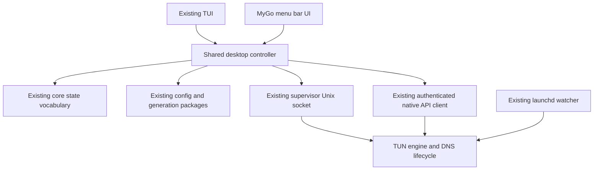

# macOS menu bar GUI feasibility research

Research date: 2026-10-22. Status: research and recommendation; no implementation or framework adoption has been approved.

## Recommendation

Offer a separate, unprivileged macOS menu bar application alongside the existing CLI/TUI. MyGo is a credible candidate: its released v0.6.2 already contains a native tray-anchored NSPopover, an official working-example source, an accessory application policy, and the controls needed for the first surface.

Start a feasibility prototype with **MyGo v0.6.2 + its Go-native `ui` package**. Evaluate **Onevra v0.2026.14** for consistent controls, theme and Lucide icons. Keep Onevra optional until its published release has been built and exercised against the selected MyGo version. The application can own its MyGo flyout directly and use Onevra components inside it; Onevra's desktop window shells are unnecessary for a menu bar panel.

Keep the TUN, DNS lifecycle and fallback watcher in their existing services. The GUI is another client of those services, with the same state vocabulary and configuration as the TUI.

## Evidence and version boundaries

| Item | Verified evidence | Consequence |
| --- | --- | --- |
| MyGo identity | `github.com/egoist/mygo`, MIT licensed | This is the actual project named by the request. |
| Released baseline | GitHub releases API returned v0.6.2, published 2026-10-21, `prerelease: false` | Pin a version; this remains a young v0.x project despite the release flag. |
| Native menu bar panel | v0.6.2 `examples/menubar-flyout/main.go` uses `NewTray`, `NewFlyout`, `Tray`, `Focusable: true`, `Popover: true` | The core menu bar interaction is present in a release, not only on main. |
| Native macOS presentation | v0.6.2 `internal/darwin/popover.go` constructs `NSPopover` and anchors it to the tray status-item button | System placement, material, arrow and transient dismissal are available. |
| Background-only identity | `ActivationPolicyAccessory`, `LSUIElement`, `OnWindowAllClosed` | No Dock icon; closing the only panel need not quit the app. |
| Toolchain | MyGo v0.6.2 requires Go 1.27.1; this repository's `mise.toml` already pins Go 1.27.1 | No runtime installation is indicated. Root `go.mod` currently says Go 1.26.6, so adding MyGo to that module would raise its minimum and affect CI/mobile module consumers. |
| Onevra published release | Latest release API returned `source/v0.2026.14`, published 2026-10-21 | Its Go module version is `github.com/oneo-me/onevra/source@v0.2026.14`. |
| Onevra compatibility distinction | Published `source/v0.2026.14/source/go.mod` requires MyGo v0.6.0; main's `source/go.mod` requires v0.6.2 | An application selecting MyGo v0.6.2 will upgrade that dependency. Compatibility has not been compiled or run in this research. |
| Native controls | Released MyGo UI index includes segmented controls, search, virtualized lists, forms, dialogs, charts and accessibility guidance | A separate widget toolkit is optional. |

MyGo's repository was created on 2026-09-26 according to the retrieved search metadata; Onevra's GitHub API reports creation on 2026-10-06. These dates indicate limited public history, not a measured defect rate. Both projects are evolving quickly. MyGo main was inspected at `5bb0f957371fe7921fa975be8060aa2abebc16c8`; release-specific claims above were separately checked against v0.6.2.

## Stack and component options

| Option | Useful contribution | Assessment for sakamoto |
| --- | --- | --- |
| MyGo `ui` alone | Layout, native-rendered controls, theme, keyboard/IME support, lists, forms, status elements and charts | Lowest dependency count. Recommended prototype baseline. |
| MyGo + Onevra | Consistent styled controls, theme, named Lucide SVG accessors, menu bar example and starter structure | Best companion candidate. Adopt selectively after compatibility and native interaction checks. |
| MyGo + selected Lucide SVG assets | Small icon vocabulary through MyGo's SVG support | Sufficient if Onevra is otherwise unnecessary; preserve asset licenses. The tray itself uses a template PNG, separately from in-panel SVG icons. |
| MyGo `plugins/glass` | Shader-rendered glass effects within a window | Optional visual material. Its backdrop is content painted in the same window; it does not replace the system NSPopover material. |
| MyGo `plugins/loading` | Additional Go-native loading indicators | Optional; a built-in spinner and explicit pending text are sufficient initially. |
| 8bitMyGoUI | Pixel-art controls, palettes, icons and a large showcase; main declares MyGo v0.6.2 | A real companion library, but its console-game visual language offers little benefit for this operational utility. Not recommended as the default surface. |
| MyGo webview + a web component library | WKWebView and generated typed Go/TypeScript bindings; permits familiar web tooling | Feasible alternative if rich web content becomes important. Adds a frontend build and webview lifecycle; current menu bar requirements are covered by Go-native UI. |

MyGo's term "native UI" means its own GPU-rendered controls, rather than AppKit widgets for every button and input. On macOS the panel shell can still be a real NSPopover. Native appearance, accessibility and input behavior therefore need application-level validation.

Onevra's current README says packaging uses MyGo's CLI and that it adds no packager. A search-indexed description still mentioned a separate Packer; prefer the repository evidence. Both MyGo and Onevra code use MIT licenses, compatible with retaining sakamoto's GPL-3.0-or-later license and attribution obligations.

## Existing code that can be reused

| Existing code | GUI use | Boundary to preserve |
| --- | --- | --- |
| `internal/core/session.go`, `probe.go`, `node.go`, `mode.go`, `configstate.go` | Connection phase, network verification, node state, routing mode and pending configuration state | A running TUN or selected node does not establish reachability. |
| `internal/svc/client.go` | Supervisor commands over its Unix socket | All privileged connection/DNS lifecycle remains in the daemon. Commands can take tens of seconds and must run off the UI thread. |
| `internal/security/staged.go:ConnectWithPending` | Connection with staged API credentials | GUI connect must reuse this flow rather than reduce it to a bare supervisor command. |
| `internal/sbclient/client.go` | Groups, status, mode and traffic subscriptions; selection and latency tests | Stream reconnection and cancellation belong to a shared controller, with UI projections fed from snapshots. |
| `internal/config`, `internal/gen`, `internal/icloud`, `internal/s3sync` | Loading, generation, sources and optional synchronization | Keep existing runtime path resolution and explicit synchronization boundaries. |
| `internal/tui/actions.go`, `tui.go`, `network.go`, `latency.go` | Reference for application workflows still coupled to Bubble Tea | Extract the needed workflows into a UI-independent controller before duplicating them in the GUI. |

For example, choosing a leaf of an automatic group currently selects that leaf in `ManualPick` and then selects `ManualPick` in `MainProxy`. A simple one-call node picker would change fallback/manual-selection semantics.

The supervisor also exposes bounded `state`, `select`, `urltest` and `reload` commands. Its `state` projection does not replace the full authenticated streaming API for mode, metrics, logs and connections. A minimal socket-only panel is possible, but is less complete than the current TUI's data path.

Suggested architecture:

A possible implementation shape is `cmd/sakamoto-menubar` plus a narrowly scoped `internal/desktop` controller. Keep MyGo imports confined to the GUI target. A root-module implementation is straightforward but changes the shared dependency graph; module isolation can be considered if keeping desktop dependencies out of mobile dependency resolution proves valuable. Neither layout has been implemented here.

The controller should own cancellable subscriptions, serialize lifecycle requests and publish snapshots. GUI state updates from background work should use MyGo's main-thread scheduling, such as `Window.Update`; do not retain frame-local `ui.Element` values. A panel may disappear while a request remains active, so application operation state must outlive the current panel instance.

## Proposed product scope

This is a research proposal, not a confirmed visual design. Interpret "menu bar only" as a resident menu bar icon with an anchored panel and in-panel navigation. The initial proposal has no separate main/settings window.

Primary panel content, in order:

1. Observed connection phase, short diagnostic context and Connect/Disconnect action.
2. Rule / Global / Direct selection, showing only modes available from the running core.
3. Active chain/group and node selection, with search when the list grows. Keep selection and tested reachability visually distinct.
4. Latency-test action and compact traffic totals/rates when the panel is visible.
5. In-panel configuration/settings navigation and a clear Quit App action. Keep advanced editing in the existing TUI during the initial prototype.

Use text and icon shape as well as color for service states. Preserve explicit states for disconnected, starting, TUN running, verified reachable, unverified, conflict, unavailable and stopping. Do not flatten them into a green/red connection toggle.

A native right-click menu can expose quick actions and Quit App. Register a single GUI instance so repeated launches do not create extra status items. `LSUIElement` belongs in the packaged Info.plist, with the accessory policy also set for development runs.

Closing the panel leaves the app resident. Quitting the GUI should, by default, leave the independently controlled tunnel running; stopping the tunnel is an explicit Disconnect action. Opening the app at login should be opt-in and should not imply VPN autoconnection. These are proposed semantics to validate during implementation, consistent with the repository's existing service behavior.

## Integration details that matter

- **State paths:** reuse `config.DefaultPath()` / `DefaultDir()` and legacy-daemon resolution. Do not accidentally create a second configuration under MyGo's default Application Support directory. GUI-only appearance preferences may have a separate file.
- **Multiple frontends:** reread current configuration before mutation, detect stale edits and use a coordinated write policy. A GUI single-instance lock does not serialize the TUI, watcher or synchronization writers.
- **Power use:** keep necessary service/group observation while the panel is hidden, but stop or reduce visible-only traffic/history work. Subscribe to logs/connections only when their surface needs them; avoid turning the full TUI pump into permanent hidden polling.
- **First run:** distinguish missing configuration, missing services, unavailable services and disconnected state. Reuse existing setup checks and installation authorization when implementation reaches that scope.
- **Distribution:** MyGo supports macOS bundles, arm64/Intel/universal targets, signing and notarization. The project's CLI build currently enables CGO for upstream helpers, so MyGo's no-cgo claim is not automatically a property of the final sakamoto build.
- **Installation channels:** keep the existing CLI formula; a GUI app can have its own signed app distribution/Homebrew cask. Installing or launching the GUI should preserve the existing explicit setup/connect boundary.
- **Updates:** GUI app updates and privileged daemon/core updates have different lifecycles. MyGo's optional updater does not establish safe daemon replacement; retain the existing controlled update/repair path for those components. A Homebrew installation should have a clear single update owner.
- **Size and memory:** upstream advertises small binaries, low idle CPU and approximately 44 MB for a small native window. Those are upstream example measurements. They do not establish sakamoto's binary size, resident memory or hidden-panel CPU cost.

## Prototype acceptance and repeatable evidence

No prototype, runtime benchmark or dependency compatibility build was performed in this research. The next phase should prove the following before committing to a production GUI:

1. Build a packaged, isolated menu bar prototype against pinned MyGo v0.6.2. Compare built-in UI with Onevra v0.2026.14 using the same panel. Record the resolved module graph and build result for both combinations.
2. Verify no Dock icon or normal app-switcher entry; single-instance launch; panel toggle; click-outside and Escape dismissal; template icon appearance; right-click menu; multi-display placement and behavior around full-screen Spaces.
3. Exercise fake service/API scenarios first: unavailable daemon, reconnecting streams, pending connect/disconnect, failed probe, selected-but-untested node and stale configuration. Save screenshots plus a scenario receipt with expected/observed state.
4. Validate Chinese IME composition, keyboard navigation, VoiceOver labels, dark/light appearance and reduced-transparency behavior in the actual packaged app.
5. Measure startup, closed-panel idle CPU/memory, visible-panel CPU/memory, repeated opening/closing, and operation completion after the panel is dismissed. Keep a timestamped machine/OS/build manifest and samples.
6. Verify simultaneous TUI and GUI observations and configuration edits. Live TUN connection testing can follow in a deliberate test session; this research did not change the live tunnel.
7. Produce a versioned app artifact, checksums, screenshots, a machine-readable scenario report and repeatable verification commands. Signing/notarization and service-update behavior need separate release verification before distribution.

If MyGo fails the macOS interaction/accessibility checks, the strongest platform-specific fallback is an AppKit/SwiftUI menu bar shell using the same Go controller boundary. Existing iOS SwiftUI experience is useful, but its NetworkExtension lifecycle should not be transplanted into this desktop supervisor design.

## Primary sources

Release and code evidence:

- [MyGo v0.6.2 release](https://github.com/egoist/mygo/releases/tag/v0.6.2)
- [Released native menu bar flyout example](https://github.com/egoist/mygo/blob/v0.6.2/examples/menubar-flyout/main.go)
- [Released alternative frameless menu bar example](https://github.com/egoist/mygo/tree/v0.6.2/examples/menubar-native)
- [Released flyout options](https://github.com/egoist/mygo/blob/v0.6.2/flyout.go)
- [Released macOS NSPopover implementation](https://github.com/egoist/mygo/blob/v0.6.2/internal/darwin/popover.go)
- [Released MyGo UI index](https://github.com/egoist/mygo/blob/v0.6.2/docs/ui/README.md)
- [Released application lifecycle and login behavior](https://github.com/egoist/mygo/blob/v0.6.2/docs/app.md)
- [Released toolchain requirements](https://github.com/egoist/mygo/blob/v0.6.2/go.mod)
- [Onevra repository and component overview](https://github.com/oneo-me/onevra)
- [Onevra v0.2026.14 release](https://github.com/oneo-me/onevra/releases/tag/source/v0.2026.14)
- [Onevra published dependency manifest](https://github.com/oneo-me/onevra/blob/source/v0.2026.14/source/go.mod)
- [Onevra published menu bar example](https://github.com/oneo-me/onevra/tree/source/v0.2026.14/source/examples/menubar)
- [8bitMyGoUI repository](https://github.com/ELY-Open-Source/8bitMyGoUI)

Additional official guidance, inspected from the pinned MyGo main snapshot where applicable:

- [Distribution and signing](https://mygo.egoist.dev/docs/distribution)
- [Menus and tray](https://mygo.egoist.dev/docs/menus)
- [State, main-thread updates and view lifetimes](https://mygo.egoist.dev/docs/ui/views)
- [Glass plugin scope](https://mygo.egoist.dev/docs/plugins/glass)
- [SVG icon support](https://mygo.egoist.dev/docs/ui/icon)

## Search coverage and limits

Attempted opencli Google once with `"mygo" "GUI" Go macOS`; navigation was rejected. Attempted opencli Gemini once to identify the toolkit and compare tray/popover support; the command timed out and no answer was used. No message to another person was sent.

Fallback web search used Exa through the search tool for toolkit identity, official tray/UI support and companion component libraries: three successful batches, ten query strings total. A final two-query expansion for Onevra/8bit failed with no available provider and contributed no evidence. GitHub repository search was used once for `8bit mygo` to locate the original component project. Primary README files, versioned source files, module manifests and release metadata were then fetched directly from GitHub with curl. The Onevra website fetch timed out; its repository was reachable and supplied the evidence used above.

Opencli/Google and Gemini were not retried. No tools were installed, no application dependencies were added and no GUI or tunnel was started. This report's conclusions establish source-level feasibility; operating behavior remains to be demonstrated by the prototype.
